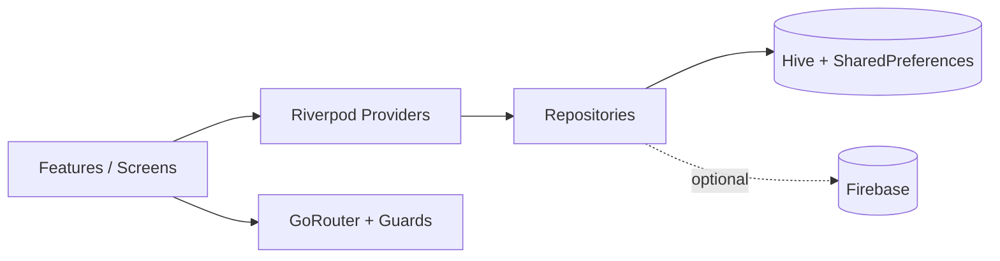

<div align="center">


# ✨ Aesthetica

### Premium AI-powered fitness app: smart workouts, combat training, tracking & gamification

[](https://flutter.dev)
[](https://dart.dev)
[](https://riverpod.dev)
[](https://pub.dev/packages/go_router)
[](https://pub.dev/packages/hive)
[](#-platform-support)
[](#)

[Overview](#-overview) · [Screens](#-app-screens) · [Features](#-features) · [Tech Stack](#-tech-stack) · [Architecture](#-architecture) · [Getting Started](#-getting-started) · [Roadmap](#-roadmap)

</div>

---

## 📖 Overview

**Aesthetica** is a cross-platform fitness application built with **Flutter** that brings everything a modern fitness enthusiast needs into one polished app:

- A searchable library of **800+ exercises**
- **Live workout sessions** with rep counter, rest timer and set tracking
- An **AI workout generator** that builds plans from your goals, BMI and experience
- **Combat fitness** programs: Boxing, Muay Thai and MMA
- A **smart tracker** for water, mood, energy, recovery and body measurements
- **Analytics** across weekly, monthly and yearly ranges
- **Gamification**: XP, levels, streaks, coins and achievements

The app is **offline-first** (Hive + SharedPreferences), uses **Riverpod** for state management and **GoRouter** for guarded navigation, and is **Firebase-ready** for cloud sync.

---

## 📱 App Screens

> 📸 Every screen below maps to a real route in the app. Add your screenshots to `assets/screenshots/` using the exact file names shown under each section and they will render automatically.

### 1. Splash Screen: `/`

Animated brand intro shown on launch while the app initializes local storage and decides where to send the user (onboarding, login or home).

<div align="center">
  
</div>

---

### 2. Onboarding: `/onboarding`

First-run walkthrough that introduces the main capabilities of the app. Shown only once; completion is stored as a flag in SharedPreferences.

<div align="center">
  
  
  
</div>

---

### 3. Authentication: `/login` and `/signup`

Email sign-up and sign-in, plus **Guest mode** so users can try the app instantly. Auth state is handled by a Riverpod `StateNotifier` and enforced by GoRouter guards. Firebase Auth can be plugged in for cloud accounts.

<div align="center">
  
  
</div>

---

### 4. Dashboard: `/home`

The main hub of the app:

- Activity rings and daily progress
- Weekly activity charts
- Body metrics summary
- XP, level and streak overview
- Quick access to workouts, combat sessions and the AI generator

<div align="center">
  
</div>

---

### 5. Exercise Library: `/home/workouts`

Browse **800+ exercises** with live search, category tabs and difficulty filters. Tap any exercise to view details and start a session.

<div align="center">
  
  
</div>

---

### 6. Live Workout Session: `/workout/session`

A guided workout player with:

- Rep counter and set tracking
- Automatic rest timer between sets
- XP rewards on completion
- Workout saved to local history

<div align="center">
  
  
  
</div>

---

### 7. AI Workout Generator: `/ai-generator`

Generates a personalized plan from the user's **goal**, **BMI** and **experience level**, so every plan fits the person instead of a one-size-fits-all template.

<div align="center">
  
  
</div>

---

### 8. Combat Fitness: `/combat/:id`

Dedicated **Boxing**, **Muay Thai** and **MMA** programs with a live combat session player (rounds, timers and guided drills).

<div align="center">
  
  
</div>

---

### 9. Smart Tracker

Log and review daily wellness data. Everything is **persisted locally with Hive**:

- 💧 Water intake
- 😊 Mood
- ⚡ Energy
- 🛌 Recovery
- 📏 Body measurements

<div align="center">
  
  
</div>

---

### 10. Analytics

Visual progress insights built with `fl_chart`, available in **weekly**, **monthly** and **yearly** views.

<div align="center">
  
  
  
</div>

---

### 11. Gamification and Achievements

Stay motivated with **XP**, **levels**, **streaks**, **coins** and unlockable **achievements** earned by completing workouts and hitting goals.

<div align="center">
  
</div>

---

### 12. Profile: `/profile/edit`

View and edit profile details (name, body metrics, goals) that feed the AI generator and dashboard.

<div align="center">
  
  
</div>

---

### 13. Notification Settings: `/settings/notifications`

Configure local **workout** and **hydration** reminders scheduled with `flutter_local_notifications` and `timezone`.

<div align="center">
  
</div>

---

## 🚀 Features

| Feature | Description |
|---|---|
| 📊 **Dashboard** | Activity rings, daily progress, weekly charts and body metrics |
| 🏋️ **800+ Exercises** | Searchable library with categories and difficulty filters |
| ⏱️ **Live Workout Sessions** | Rep counter, rest timer, set tracking and XP rewards |
| 🤖 **AI Workout Generator** | Personalized plans from goals, BMI and experience |
| 🥊 **Combat Fitness** | Boxing, Muay Thai and MMA with a live session player |
| 💧 **Smart Tracker** | Water, mood, energy, recovery and body measurements (persisted) |
| 📈 **Analytics** | Weekly, monthly and yearly charts |
| 🎮 **Gamification** | XP, levels, streaks, coins and achievements |
| 🔐 **Authentication** | Email sign-up/sign-in and guest mode (local); Firebase-ready |
| 🔔 **Notifications** | Local workout and hydration reminders |
| 🎨 **Polished UI** | Google Fonts, shimmer loading, Lottie and flutter_animate motion |
| 📴 **Offline-first** | Fully functional without a backend |

---

## 🛠️ Tech Stack

| Category | Technology |
|---|---|
| **Framework** | Flutter 3.38+ · Dart 3.10+ |
| **State Management** | `flutter_riverpod`, `riverpod_annotation`, `riverpod_generator` |
| **Navigation** | `go_router` with auth and onboarding guards |
| **Local Storage** | `hive_flutter`, `shared_preferences` |
| **Networking** | `dio` |
| **Models / Codegen** | `freezed`, `json_serializable`, `equatable`, `build_runner` |
| **Charts & Progress** | `fl_chart`, `percent_indicator` |
| **UI & Animation** | `google_fonts`, `flutter_animate`, `shimmer`, `lottie`, `flutter_svg`, `cached_network_image` |
| **Notifications** | `flutter_local_notifications`, `timezone` |
| **Utilities** | `intl`, `uuid`, `collection` |
| **Linting** | `flutter_lints` |

---

## 🏗️ Architecture

Aesthetica uses a **feature-first, layered architecture** that keeps UI, state and data concerns separate.



```
lib/
├── core/           # Theme, router, shared widgets, services
├── data/           # Models, repositories, exercise database
├── features/       # Feature modules (dashboard, workouts, auth, tracker, ...)
├── app.dart        # Root app widget (theme + router)
└── main.dart       # Entry point and initialization
```

### Key decisions

- **State:** Riverpod, using `StateNotifier` for user and auth state
- **Navigation:** GoRouter with redirect guards for authentication and onboarding
- **Persistence:** Hive for profile, tracker data and workout history; SharedPreferences for lightweight flags
- **Offline-first:** Everything works without a backend; cloud sync is opt-in
- **Notifications:** Scheduled locally via `flutter_local_notifications`

---

## 📂 Project Structure

### Root

| File / Folder | Purpose |
|---|---|
| `lib/` | All Dart application source code |
| `assets/` | Images, Lottie animations, icons (and README screenshots) |
| `android/` · `ios/` | Native mobile platform projects |
| `web/` · `windows/` · `macos/` · `linux/` | Web and desktop platform projects |
| `test/` | Unit and widget tests |
| `pubspec.yaml` | Dependencies, assets and app metadata |
| `pubspec.lock` | Locked dependency versions for reproducible builds |
| `analysis_options.yaml` | Dart analyzer and lint rules |
| `.metadata` | Flutter project metadata |
| `.gitignore` | Files excluded from version control |
| `README.md` | Project documentation |

### Assets

```
assets/
├── images/        # Static images
├── lottie/        # Lottie animations
├── icons/         # App icons and SVGs
└── screenshots/   # README screenshots (not required at runtime)
```

---

## 🧭 App Routes

| Route | Screen |
|---|---|
| `/` | Splash |
| `/onboarding` | Onboarding |
| `/login`, `/signup` | Authentication |
| `/home` | Dashboard |
| `/home/workouts` | Exercise library |
| `/workout/session` | Live workout player |
| `/combat/:id` | Combat session |
| `/ai-generator` | AI plan generator |
| `/profile/edit` | Profile editor |
| `/settings/notifications` | Reminder settings |

---

## ⚡ Getting Started

### Prerequisites

- [Flutter](https://docs.flutter.dev/get-started/install) **3.38+** (Dart **3.10+**)
- Android Studio or Xcode for device builds
- A connected device, emulator or simulator

Check your setup:

```bash
flutter doctor
```

### Installation

```bash
# 1. Clone the repository
git clone https://github.com/010Ankushsharma/Aesthetica.git
cd Aesthetica

# 2. Install dependencies
flutter pub get

# 3. Generate code (Freezed, JSON, Riverpod) when models or providers change
dart run build_runner build --delete-conflicting-outputs

# 4. Run the app
flutter run
```

### First launch flow

1. **Splash → Onboarding → Login** (or continue as **Guest**)
2. Complete a workout from **Workouts** or the **AI Generator**
3. Track your metrics in **Tracker**, saved locally to Hive

### Build for release

```bash
flutter build apk --release        # Android APK
flutter build appbundle --release  # Android App Bundle
flutter build ios --release        # iOS
flutter build web --release        # Web
```

---

## 🔥 Firebase Setup (Optional)

Enable cloud authentication, Firestore sync and push notifications:

```bash
dart pub global activate flutterfire_cli
flutterfire configure
```

Then add the packages to `pubspec.yaml`:

```yaml
dependencies:
  firebase_core: ^latest
  firebase_auth: ^latest
  cloud_firestore: ^latest
```

> ⚠️ Never commit `google-services.json`, `GoogleService-Info.plist` or API keys to a public repository.

---

## 🖥️ Platform Support

| Platform | Status |
|---|---|
| Android | ✅ Primary target |
| iOS | ✅ Primary target |
| Web | ⚙️ Supported by project scaffold |
| Windows / macOS / Linux | ⚙️ Supported by project scaffold |

---

## 🧪 Testing & Code Quality

```bash
flutter test        # run unit and widget tests
flutter analyze     # static analysis (flutter_lints)
dart format .       # format the codebase
```

---

## 🛠️ Troubleshooting

| Problem | Fix |
|---|---|
| Generated files missing (`*.g.dart`, `*.freezed.dart`) | Run `dart run build_runner build --delete-conflicting-outputs` |
| Dependency conflicts | `flutter clean && flutter pub get` |
| Notifications not showing on Android 13+ | Grant the notification permission in system settings |
| Hive data looks stale during development | Clear app storage or reinstall the app |

---

## 🗺️ Roadmap

- [ ] Firebase auth and Firestore cloud sync
- [ ] Push notifications (FCM)
- [ ] Wearable and health-platform integration
- [ ] Social features: leaderboards and friend challenges
- [ ] Exercise video and animation previews
- [ ] Theme customization (dark/light)
- [ ] Localization (i18n)

---

## 🤝 Contributing

Contributions, issues and feature requests are welcome!

1. Fork the project
2. Create your branch: `git checkout -b feature/amazing-feature`
3. Commit your changes: `git commit -m "feat: add amazing feature"`
4. Push to the branch: `git push origin feature/amazing-feature`
5. Open a Pull Request

---

## 📄 License

This is currently a **private project**, not for publication. Contact the author for usage permissions.

---

## 👨‍💻 Author

**Ankush Sharma**

[](https://github.com/010Ankushsharma)

---

<div align="center">

⭐ If you like this project, give it a star!

</div>